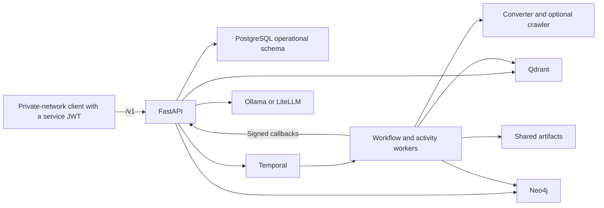

# Architecture

FastAPI authorizes requests and records ingestion state in PostgreSQL.
Temporal records workflow history and routes tasks. The workflow worker
executes the workflow code, and activity workers carry out its scraping,
conversion, and indexing steps.

The backend verifies issuer, audience, signature, service identity, tenant,
scopes. Dataset query and ingestion routes check the corresponding exact grant.
The authorized dataset record selects the storage targets for queries and
ingestion. External applications authenticate their users and request service
tokens from the configured issuer.

The backend and infrastructure listen on private Docker networks. Workers sign
the callback body before sending it to FastAPI. Only the Temporal scraper
worker sends HTTP requests to the crawler.
