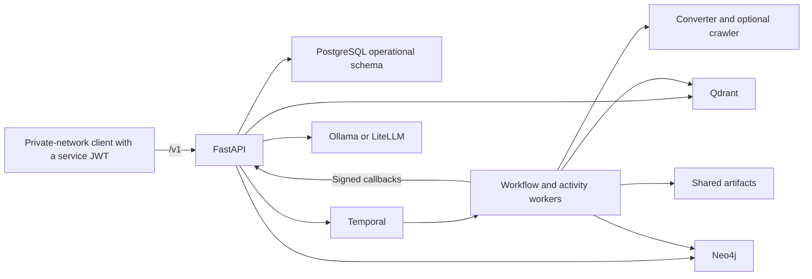

# Architecture

The backend verifies issuer, audience, signature, service identity, tenant,
scopes and exact dataset grants. Query and ingestion resolve their physical
store targets from authorized dataset metadata. External applications own
their human authentication and request service tokens from the configured issuer.

The backend and infrastructure listen on private Docker networks. Workers sign
the original callback bytes and submit them through the project network.
