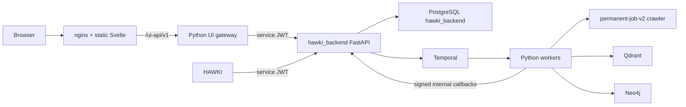

# Python RAG deployment

This guide covers configuration, startup and operations for the Python RAG system.

## Architecture and authority



HAWKI owns human login and management authorization. FastAPI authenticates
registered service identities using asymmetric JWT validation and HTTPS JWKS,
then enforces tenant, action/scope and exact dataset grants. It has no mirrored
human account, password or browser-session implementation.

The default UI gateway mode checks a HAWKI authorization endpoint (204 means
management approved; all other outcomes deny access) and injects its own service JWT.
The explicit local overlay uses `HAWKI_RAG_UI_ACCESS_MODE=local`: loopback-only
nginx and Host/origin checks form the trusted boundary. The browser supplies no
username, password, Basic/Bearer token or identity cookie. The internal local
issuer exposes only HTTPS service token/JWKS/health endpoints; it has no browser
login or `/authorize` route.
Service tokens, signing keys, client secrets and database credentials never enter
frontend JavaScript or browser-visible environment variables. Its exact origin
check protects mutations. Worker callbacks retain signed HMAC bytes, replay-window
checks and durable ownership; public nginx blocks `/internal/*`.

## Configuration and schema

Use `.env.example` for shared infrastructure/worker settings and
`docker/env/epoch15c.cutover.env.example` for backend-only settings. The latter
is a placeholder template for the ignored `docker/env/epoch15c.cutover.env`.
`python_backend/.env.example` documents the full API settings.

Provision these before starting:

1. PostgreSQL database, dedicated restricted runtime role, and Alembic revision
   **0009**. Run `make migrate-core` only with an operator-supplied migration DSN;
   the API runtime role must not have DDL or access to historical public tables.
2. An HTTPS asymmetric JWT issuer/JWKS, issuer/audience/key ID and registered
   **service** clients. Configure the HAWKI management authorization endpoint,
   exact UI origin and server-only service credentials/CA trust.
3. Explicit query/model/provider/reranker/store configuration. Local graph
   extraction uses real configured models, not browser-selected physical scope.
4. A crawler advertising genuine `permanent-job-v2`, signed callback credentials,
   and shared artifact permissions. The safety/readiness contract is mandatory.

Keep credentials in ignored operator files/external secret mounts. No real
credential is supplied by this repository. `HAWKI_BACKEND_SERVICE_ONLY=true`,
`HAWKI_BACKEND_LARAVEL_OFF=true` and schema readiness remain enforced. The latter
flag is retained because it refuses legacy deletion dispatch/receipts and selects
the direct Python callback policy; it does not enable a removed runtime.

## Build and start

The current base model contains FastAPI, the UI gateway, static frontend, current
Python workers, PostgreSQL, Temporal, Qdrant, Neo4j, reranker and provider services.
Production operators configure the external crawler URL; the explicit local overlay supplies the pinned upgraded crawler and
development HTTPS service issuer.

For the already-provisioned local deployment:

```sh
docker compose -f docker-compose.yml -f docker-compose.cutover.local.yml config --quiet
docker compose -f docker-compose.yml -f docker-compose.cutover.local.yml build \
  hawki_backend hawki_rag_frontend rawki_local_workflow_worker \
  rawki_local_scraper_worker rawki_local_converter_worker rawki_local_indexer_worker \
  rawki_local_crawler
docker compose -f docker-compose.yml -f docker-compose.cutover.local.yml up -d
docker compose -f docker-compose.yml -f docker-compose.cutover.local.yml \
  exec -T hawki_backend python -m hawki_backend.readiness --live
```

The gateway reuses the newly built `hawki-backend:local` image. Optional local
provisioning is implemented by `scripts/provision_local_cutover.py` and
`scripts/local_cutover_database.py`; review their explicit local-only guards
before initial use. Do not rerun provisioning to rotate an existing issuer as
part of routine startup. The local crawler source is prepared reproducibly with
`scripts/prepare_local_crawler.py`; follow `docker/crawler/README.md`.

`make up-core-local` selects the Python local overlay. `make up-core` uses the
base deployment settings; neither runs migrations implicitly. Stop/recreate
services without deleting persisted volumes. Avoid data-reset targets on deployments with retained data. When manually replacing backend/gateway containers, reload the
frontend nginx routing after their replacement if its resolved upstream address
changed.

## Frontend and development

```sh
npm ci
npm test
npm run build
npm run dev
```

`vite.frontend.config.js` builds `frontend/index.html`, `frontend/main.js` and
the existing `resources/js` Svelte/DOM modules and `resources/css` into ignored
`public/frontend`. `docker/frontend.Dockerfile` serves that output and the favicon
with nginx. The frontend uses a standalone Vite build and server-side service credentials. `/v1/*` intentionally
exposes the authenticated API; `/api/*` returns 410 for obsolete clients.

Use `make test-backend`, `make test-rag`, and `make test-frontend` for the current
test entry points. The [testing guide](../Developer/testing.md) records platform
baselines and integration requirements. Python and frontend CI require no PHP.

## Historical evidence and reservations

The 27 original `public.*` tables remain frozen evidence, documented in
[public schema history](../History/public_schema.md). Fresh Python deployments
do not execute their former source-level migrations. The removed migrations
remain available in Git at `5391cb23:database/migrations/`.

Preserve the shared volume, `/shared/.historical-orphans`,
`/shared/.crawler-runtime/legacy-archive`, reserved original job/source identities,
and every referenced file. Back them up together with historical SQL evidence.
Do not delete, relocate, adopt, seal or manufacture completion for these records.

The `gebuhren` archive records custody **UNKNOWN**, deletion **UNVERIFIED**, six
unchanged preserved files and hashes of the original 16 SQL records. It is
isolated from new admission/dispatch and is not active runtime ownership. Missing
or corrupted configured archive evidence makes new admission fail closed.
Historical crawler imports retain their own unsealed state and identity/root
reservations.

## Acceptance and operations

Required live readiness is **26/26 PASS**. Authorized UI checks include
`/ui-api/v1/ops/stats`, `/ops/health` and `/query/datasets`; missing or invalid
JWTs must return 401. Query, managed/text/URL ingestion, graph operations, download
and deletion run through Python. Graph and URL smoke scripts create unique
datasets, retire content through the API, then use separate read-only audits to
verify stores, artifacts and workflow quiescence. Immutable audit/tombstone rows
are retained by the normal lifecycle.

File uploads prepare their named dataset through the existing creation and
ingest-grant APIs before posting multipart data. Existing datasets still require
an exact ingest grant. Completed pipeline tasks request query access through the
existing readiness-checked self-grant API so indexed documents appear in lists.
Run `node scripts/smoke_local_ui_upload.mjs` to exercise the real frontend helpers,
FormData, managed indexing, listing, download and cleanup on a disposable dataset.
See [the UI API route diagnosis](ui_api_route_fixes.md).

The local crawler provides the permanent-job API without a saved profile/task UI.
`/ui-api/v1/scraper/tasks` reports an empty catalog with an explanatory message
only after validating that API's full contract and health. A configured separate
catalog, custom path, malformed contract or unhealthy upstream still fails closed.

The `hawki_bridge` Python package and historical validators remain only as inert
compatibility/reference tests. The bridge has no deployment image or service;
old live BFF activation tooling is retired. Current deployment validation is
`python -m hawki_backend.readiness --live` and the Python-only
`python_backend/scripts/cutover_readiness.py --live`.
